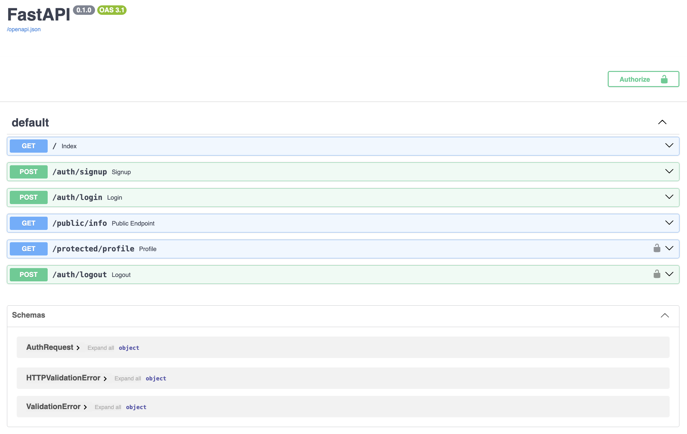

# Auth API

A small authentication API built with **FastAPI** and **Supabase Auth**. It lets users sign up, log in, and access protected routes using a JWT access token sent in the `Authorization` header. Token checking lives in one reusable dependency (`get_current_user`), so any route is protected by adding a single parameter.

## Features

- Email and password signup and login through Supabase Auth
- JWT access and refresh tokens returned on login
- Reusable auth guard for protected routes
- Input validation with clear JSON error responses
- Interactive API docs at `/docs` (Swagger UI)

## Tech Stack

- Python 3.13
- FastAPI and Uvicorn
- Supabase (hosted Postgres and Auth)

## Setup

### 1. Clone and install dependencies

```bash
git clone https://github.com/primecodes-ops/auth-api.git
cd auth-api
python -m venv .venv
source .venv/bin/activate
pip install -r requirements.txt
```

### 2. Create a Supabase project

Create a free project at [supabase.com](https://supabase.com). For testing, you can turn off email confirmation under **Authentication → Providers → Email**.

### 3. Configure environment variables

Copy the example file, then fill in your own values:

```bash
cp .env.example .env
```

Your `.env` should look like this:

```env
SUPABASE_URL=https://your-project-ref.supabase.co
SUPABASE_KEY=your-anon-public-key
PORT=3000
```

| Variable | Description | Where to find it |
|---|---|---|
| `SUPABASE_URL` | Your project's API URL | Project Settings → API |
| `SUPABASE_KEY` | The **anon (public)** key | Project Settings → API |

> Never commit `.env`. Make sure it is listed in `.gitignore`. Never use the `service_role` key in this project.

## Run

```bash
uvicorn main:app --reload
```

The server starts at `http://127.0.0.1:8000`. Interactive docs are at `http://127.0.0.1:8000/docs`.

## API Reference

| Method | Endpoint | Auth required | Description | Success response |
|---|---|---|---|---|
| `POST` | `/auth/signup` | No | Create a new account | `201` with the user object |
| `POST` | `/auth/login` | No | Log in and receive tokens | `200` with `access_token` and `refresh_token` |
| `GET` | `/public/info` | No | Public message, open to anyone | `200` with a welcome message |
| `GET` | `/protected/profile` | **Yes** | Current user's profile | `200` with `id`, `email`, `account_created` |
| `POST` | `/auth/logout` | **Yes** | Sign out | `204` (no content) |

### Request bodies

`POST /auth/signup` and `POST /auth/login`:

```json
{
  "email": "user@example.com",
  "password": "your-password"
}
```

### Authenticating requests

Send the `access_token` from login in the `Authorization` header, with the `Bearer` prefix:

```
Authorization: Bearer <access_token>
```

Example:

```bash
curl http://127.0.0.1:8000/protected/profile \
  -H "Authorization: Bearer <access_token>"
```

In Swagger UI, click **Authorize** and paste the raw token (without `Bearer `).

### Error responses

| Status | Meaning | Example body |
|---|---|---|
| `400` | Missing or invalid input | `{"detail": {"error": "Email and password are required."}}` |
| `401` | Bad credentials or missing, invalid, or expired token | `{"detail": {"error": "Access token required"}}` |
| `500` | Unexpected server error | `{"detail": {"error": "Database error."}}` |

## Swagger UI



## Project Structure

```
auth-api/
├── main.py             # FastAPI app, routes, and auth guard
├── requirements.txt    # Python dependencies
├── .env.example        # Template for environment variables
├── .env                # Your real secrets (not committed)
├── .gitignore
├── images/
│   └── swagger-ui.png  # Swagger UI screenshot
└── README.md
```